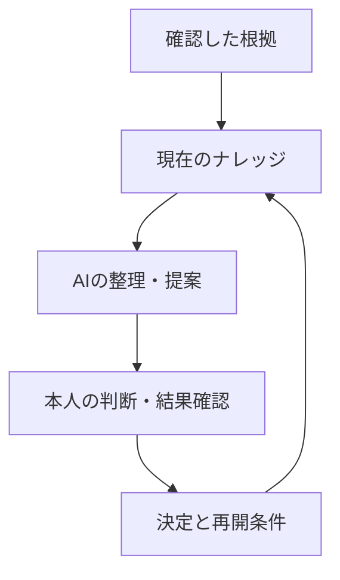

# AIと協働する業務ナレッジの運用設計

目的・根拠・決定をファイルで共有し、AIとの会話を次の作業につなげるための実績紹介です。
個人EC事業で使った運用構成をもとに、公開用のテンプレートと小さな検査ツールに再構成しています。

**この公開版の数値・案件・日付は説明用の架空データです。実際の売上や改善効果ではありません。**

## 何を解決しようとしたか

複数のAIやスレッドで仕事を進めると、過去の会話が現在の事実として扱われたり、
決定済みの論点が繰り返し提案されたりします。そこで、現在の情報、判断の根拠、
未解決事項、過去のレビューを、それぞれ参照する場所が分かる構成に整理しました。

## 担当とAIとの分担

| 担当 | 内容 |
| --- | --- |
| 辻本 篤志 | 目的設定、業務上の前提整理、運用方針・採否の判断、結果の確認 |
| 生成AI | 文書・SQL・スクリプトの原案作成、整理、検査の補助 |

コードの全行を本人が手入力した実績としては表現していません。
本公開版の整形・デモ作成・検査にも生成AIを利用しています。

## 設計したこと

| 課題 | 設計 | 公開版で確認できるもの |
| --- | --- | --- |
| 現在の事実と過去の観察が混ざる | 現在の情報とレビュー履歴を分離 | `knowledge/` と `reviews/` |
| 決定済みの話が繰り返される | 決定と再開条件を台帳に残す | [判断台帳](knowledge/08_ledger.md) |
| 他のAIへの引継ぎで前提が抜ける | 目的・既知・対象・終了条件を渡す | [引継ぎテンプレート](briefs/handoff.md) |
| 文書を直すと参照が壊れる | 更新日・リンク・ID重複を検査 | `scripts/check_knowledge.py` |



## ローカルで試す

Python 3.10以上の標準ライブラリだけで動きます。外部接続・認証は不要です。
リポジトリのルートで実行してください。

```bash
python3 scripts/check_knowledge.py --as-of 2026-01-12
python3 -m unittest discover -s tests -v
python3 scripts/new_review.py --date 2026-01-12
```

最後のコマンドは `reviews/2026-W03.md` を作成します。同じ週の既存ファイルは上書きしません。
通常の検査では `python3 scripts/check_knowledge.py` を使います。公開デモの古い確認日は警告になります。

## 実運用と、この公開版の境界

- 実運用の記録で確認できるもの：文書の所有範囲の整理、判断台帳、SQLの分離、週次レビューと文書検査スクリプトの用意。
- 公開用に作成したもの：架空のナレッジ一式、移植しやすい検査・レビュー生成コード、回帰テスト。
- この資料で主張しないもの：売上増加、工数削減率、誤りの減少率など、独立した効果測定のない成果。

2026年8月時点で保存された運用構成を題材にしています。その後の最新運用を表す資料ではありません。
詳しい背景は [ケーススタディ](docs/case-study.md)、試せる内容は [デモの説明](docs/demo.md) を参照してください。
